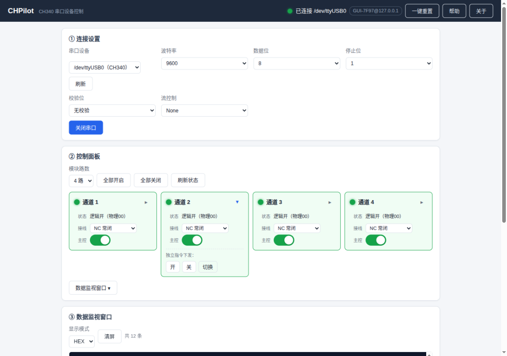
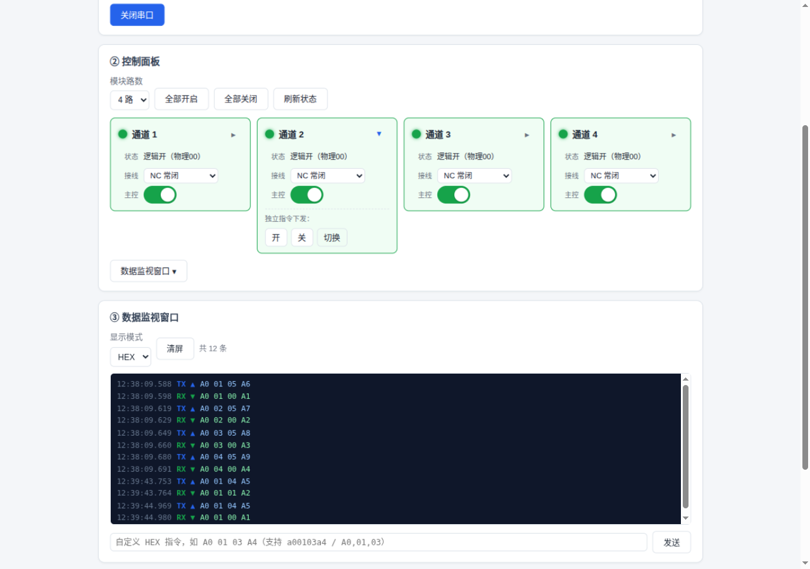
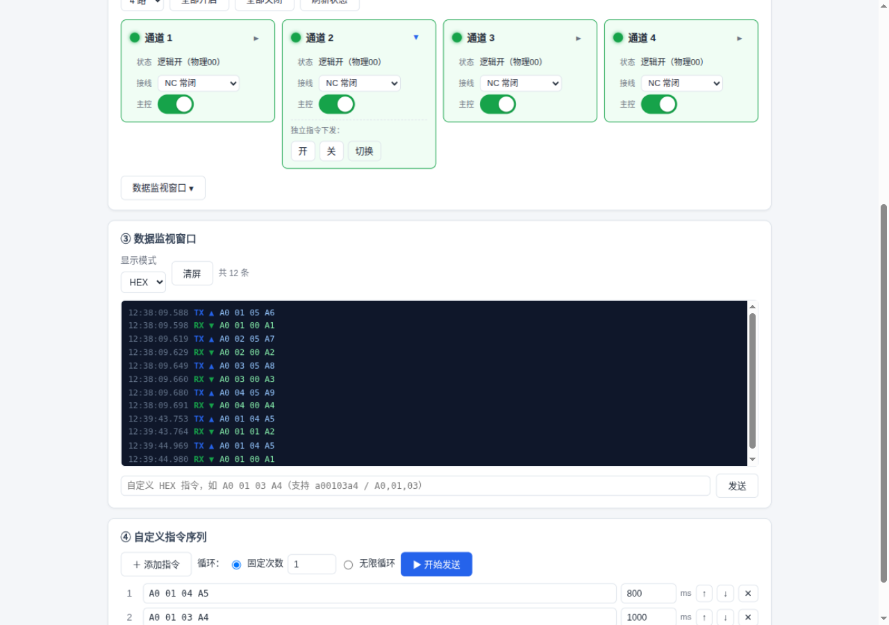
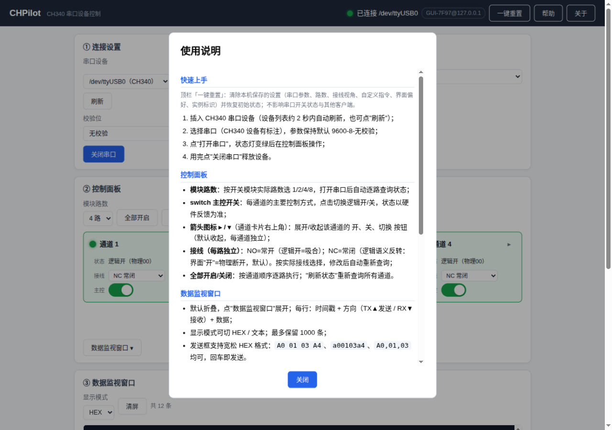
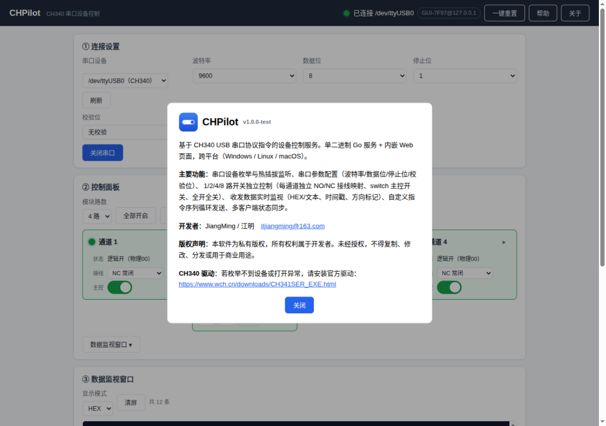

<div align="center">
  
  <h1>CHPilot</h1>
  <p><b>基于 CH340 USB 串口的设备控制台</b><br>
  单二进制 Go 服务 + 内嵌 Web 界面，浏览器即 GUI，跨平台零依赖</p>
  <p>
    
    
    
  </p>
</div>

---

CHPilot 用于通过 CH340（CH341 系列）USB 转串口模块控制通断设备：打开串口、逐路查询与开关通道、
实时监视收发数据、循环下发自定义指令。服务端为单个可执行文件（前端页面已内嵌），
无需安装运行库；任意浏览器打开即用，多客户端可同时查看，状态实时同步。

## 界面预览

| 总览 | 控制面板 |
|:---:|:---:|
|  |  |

| 数据监视窗口 | 自定义指令序列 |
|:---:|:---:|
|  |  |

| 内置帮助 | 关于 |
|:---:|:---:|
|  |  |

## 功能特性

- **串口管理**：自动枚举串口并识别 CH340 设备（VID `1A86`）；热插拔监听，插入/拔出 2 秒内自动更新设备列表
- **参数配置**：波特率 / 数据位 / 停止位 / 校验位，默认 9600-8-N-1
- **通道控制**：支持 1/2/4/8 路模块，switch 主控开关 + 开/关/切换按钮；带硬件反馈确认，状态以回包为准
- **接线视角**：每通道可独立设置 NO（常开）/NC（常闭）视角，逻辑显示随视角实时换算，并标注物理值（00/01）
- **数据监视**：所有串口收发（含打开串口时的初始化查询）带时间戳与方向标记实时显示，HEX/文本切换，支持手动发送 HEX 指令
- **指令序列**：多条自定义指令按序循环发送（固定次数 / 无限循环），每条约可设延迟，可随时停止
- **多客户端**：WebSocket 实时同步物理状态；操作提示以 toast 显示"谁做了什么"（实例标识 + 客户端 IP）
- **一键重置**：清除本机保存的全部设置，恢复初始状态
- **其他**：浏览器标签图标、Windows 可执行文件图标、单文件部署、默认仅监听本机

## 快速开始

### 1. 获取程序

从 Releases 页面下载对应平台的压缩包，解压后按平台运行启动脚本：

| 平台 | 启动脚本 | 说明 |
|------|---------|------|
| Windows | `windows/start-local.bat` | 仅本机访问（默认，最安全）<br>`start-lan.bat` 允许局域网访问 |
| Linux | `linux/./start-local.sh` | 仅本机访问<br>`./start-lan.sh` 允许局域网访问 |
| macOS | `macos/./start-local.sh` | 仅本机访问<br>`./start-lan.sh` 允许局域网访问 |

启动脚本会按 CPU 架构自动选择二进制。也可以用命令行自定义监听地址：

```bash
./chpilot-linux-amd64                # 默认 127.0.0.1:8080，仅本机
./chpilot-linux-amd64 -addr :8080    # 允许局域网访问
./chpilot-linux-amd64 -version       # 查看版本号
```

启动后浏览器打开 <http://127.0.0.1:8080> 即可。

> **Windows 提示**：局域网模式首次启动会弹出防火墙提示，请勾选"专用网络"并允许；
> 仅本机模式不会弹窗。双击 exe 也可运行（等价于仅本机模式）。

> **Linux 提示**：若无执行权限，先 `chmod +x start-*.sh`；访问串口需要 dialout 组权限：
> `sudo usermod -aG dialout $USER`（重新登录后生效）。
> 运行 `linux/install-desktop.sh` 可把 CHPilot 添加到应用菜单（含图标）。

### 2. CH340 驱动

- **Windows**：多数系统已内置；若设备管理器看不到 CH340，请安装官方驱动 [CH341SER.EXE](https://www.wch.cn/downloads/CH341SER_EXE.html)
- **Linux**：内核自带 `ch341` 驱动，插入后出现 `/dev/ttyUSB0`
- **macOS**：较新系统已内置；异常时同样安装 WCH 官方驱动

## 使用说明

### ① 连接设置

1. **串口设备**：下拉框自动列出本机串口，CH340 设备标注"（CH340）"；插入/拔出设备后列表 2 秒内自动刷新，也可点"刷新"手动枚举
2. **参数**：一般保持默认 9600-8-N-1 即可（市售 CH340 模块出厂默认）
3. 点 **打开串口**：状态灯变绿后即可操作；失败时红色提示条给出具体原因（权限不足 / 被占用 / 设备不存在 / 驱动异常等）
4. 用完点 **关闭串口** 释放设备；程序退出（含 Ctrl+C）也会自动关闭，不会残留占用

所有配置保存在浏览器本地，下次打开自动恢复。

### ② 控制面板

- **模块路数**：按实际模块选 1/2/4/8。路数是**各客户端的本地设置**，多个浏览器可各设不同路数互不影响；未连接串口时也可先设置
- **每路通道卡片**：
  - **状态**：`逻辑开/关（物理00/01）`——物理 00 表示线圈释放、01 表示线圈吸合；逻辑值按本通道接线视角换算，"状态未知"表示查询未得到反馈
  - **接线**：该通道的接线视角（NO 常开 / NC 常闭），**每个浏览器独立保存**，切换即时生效并重新显示逻辑状态
  - **主控**：switch 主控开关，点击即切换该通道逻辑开/关，状态以硬件反馈为准
  - **箭头图标 ▸/▾**（卡片右上角）：展开/收起该通道的 开 / 关 / 切换 三个独立指令按钮
- **全部开启 / 全部关闭**：按各通道接线视角顺序逐路执行
- **刷新状态**：重新逐路查询当前状态

> **NO / NC 接线视角说明**：这两种视角描述的是"负载接在继电器的哪条线上"。
> 界面上的"逻辑开"始终表示**该负载得电**：
> - 选 **NC（常闭）**：逻辑开 = 继电器释放（COM—NC 导通）
> - 选 **NO（常开）**：逻辑开 = 继电器吸合（COM—NO 导通）
>
> 同一继电器的 NO 线与 NC 线永远一条通、一条断，两者状态互为反相。

### ③ 数据监视窗口

默认收起，点"数据监视窗口"展开：

- 每行一条记录：**时间戳 + 方向 + 数据**，`TX ▲`（蓝）为发送、`RX ▼`（绿）为接收
- 打开串口时的初始化查询、面板操作、指令序列、手动发送的所有收发都会显示；后打开的页面会自动回放最近 1000 条
- **显示模式**：HEX / 文本 可切换（文本模式下不可打印字符以 `·` 占位）
- **发送框**：输入 HEX 指令点"发送"（或回车）。支持宽松格式：`A0 01 03 A4`、`a00103a4`、`A0,01,03`、`0xA0 0x01` 均可

### ④ 自定义指令序列

- **＋ 添加指令**：每行一条 HEX 指令，可设置发送后的延迟（毫秒，最小 50ms 生效）
- **↑ ↓** 调整顺序，**✕** 删除；序号即执行顺序
- **循环模式**：固定次数（1~9999）或无限循环
- **▶ 开始发送**：按序循环执行，按钮变为 **■ 停止**；执行中显示轮次进度，停止后立即释放串口供其他操作使用
- 序列中的指令若被识别为合法协议帧，会同步更新通道状态并广播到所有客户端

### ⑤ 多客户端与协作

- 多个浏览器/设备同时打开时，**物理状态实时同步**；串口为独占资源，所有指令在服务端排队串行执行
- 页面底部 **toast** 提示"谁做了什么"：操作者标识为「GUI 编号@客户端 IP」，例如
  `将通道【1】的物理值设置为：[01]，通路状态 [NC ：关，NO ：开]`（本机操作标注"本机"）
- 顶栏显示本机标识，便于多人协作时辨认是哪台机器在操作
- 各客户端的**路数、接线视角、串口参数、自定义指令**互不影响（本地保存）

### ⑥ 一键重置

顶栏 **一键重置** 清除本机保存的全部设置（串口参数、路数、接线视角、自定义指令、界面偏好、实例标识）
并自动重载，恢复到初始状态。不影响串口当前开关状态，也不影响其他客户端。

## 常见问题

| 现象 | 原因与处理 |
|------|-----------|
| 设备列表为空 | 检查 USB 连接与驱动；插入设备后列表 2 秒内自动刷新 |
| 打开报"无串口访问权限"（Linux） | `sudo usermod -aG dialout $USER`，注销重登 |
| 打开报"被其他程序占用" | 关闭占用该端口的串口工具；确认没有同时运行多个 CHPilot 实例 |
| 提示"串口操作超时" | 底层驱动无响应（劣质芯片或休眠唤醒后）：重新插拔设备再试 |
| 状态显示"状态未知" | 查询 200ms 内无反馈：确认波特率、模块供电、接线是否松动 |
| 点开关无反应但监视窗口有收发 | 接线视角 NO/NC 与实际接线不符，或模块未供电 |
| 页面提示"连接已断开，正在重连" | 服务已停止或网络中断；重新启动服务，页面会自动重连并刷新状态（切回标签页立即重连） |
| 局域网其他设备打不开 | 需用 `-addr :8080` 启动；检查系统防火墙是否放行该端口 |
| 设备一直"被占用"打不开 | 确认旧的 CHPilot 进程已退出（任务管理器 / `pgrep`） |

## 指令协议定义

以下为 CHPilot 当前适用的串口指令协议（CH340/CH341 系列 USB 通断模块通用格式）。
串口参数默认 **9600-8-N-1，无流控**。

### 帧格式（定长 4 字节）

| 字节 | 名称 | 取值 | 说明 |
|:---:|------|------|------|
| `B0` | 起始标志 | 固定 `0xA0` | 帧头 |
| `B1` | 通道号 | `0x01` ~ `0xFE` | 表示第 1 ~ 254 路 |
| `B2` | 操作码 | 见下表 | 下发为动作，反馈为状态 |
| `B3` | 校验和 | `(B0 + B1 + B2) & 0xFF` | 前三字节之和取低 8 位 |

**下发帧**的 `B2` 表示要执行的动作；**反馈帧**与下发帧结构完全一致，仅 `B2` 含义不同：
反馈帧 `B2` 只有 `0x00`（物理关，线圈释放）或 `0x01`（物理开，线圈吸合）。

### 下发操作码

| 操作码 | 含义 | 是否反馈 | CHPilot 使用场景 |
|:---:|------|:---:|------|
| `0x00` | 关 | 否 | 自定义指令 / 手动发送 |
| `0x01` | 开 | 否 | 自定义指令 / 手动发送 |
| `0x02` | 关 | 是 | 面板关闭操作（NO 视角）；NC 视角下的"逻辑开" |
| `0x03` | 开 | 是 | 面板开启操作（NO 视角）；NC 视角下的"逻辑关" |
| `0x04` | 取反（状态翻转） | 是 | 面板"切换"按钮、序列中的取反指令 |
| `0x05` | 查询当前状态 | 是 | 打开串口后的逐路初始化查询、"刷新状态" |

> 面板控制默认使用**带反馈**指令（`0x02`/`0x03`/`0x04`），以硬件回包确认最终状态；
> 反馈读取超时 200ms，超时则该路状态标记为"状态未知"。

### 反馈帧

| 字段 | 取值 | 说明 |
|:---:|------|------|
| `B0` | `0xA0` | 起始标志 |
| `B1` | 通道号 | 与请求通道一致 |
| `B2` | `0x00` / `0x01` | **物理状态**：`0x00` 关（线圈释放）、`0x01` 开（线圈吸合） |
| `B3` | 校验和 | 同下发帧算法 |

CHPilot 对收到的帧做三重校验（长度、起始符与校验和、通道号匹配），校验不通过的数据
仍会如实显示在数据监视窗口，但不会用于更新通道状态。

### 指令速查表

| 通道 | 开 | 关 | 开（带反馈） | 关（带反馈） | 取反 | 查询 |
|:---:|:---:|:---:|:---:|:---:|:---:|:---:|
| 1 | `A0 01 01 A2` | `A0 01 00 A1` | `A0 01 03 A4` | `A0 01 02 A3` | `A0 01 04 A5` | `A0 01 05 A6` |
| 2 | `A0 02 01 A3` | `A0 02 00 A2` | `A0 02 03 A5` | `A0 02 02 A4` | `A0 02 04 A6` | `A0 02 05 A7` |
| 3 | `A0 03 01 A4` | `A0 03 00 A3` | `A0 03 03 A6` | `A0 03 02 A5` | `A0 03 04 A7` | `A0 03 05 A8` |
| 4 | `A0 04 01 A5` | `A0 04 00 A4` | `A0 04 03 A7` | `A0 04 02 A6` | `A0 04 04 A8` | `A0 04 05 A9` |
| 5 | `A0 05 01 A6` | `A0 05 00 A5` | `A0 05 03 A8` | `A0 05 02 A7` | `A0 05 04 A9` | `A0 05 05 AA` |
| 8 | `A0 08 01 A9` | `A0 08 00 A8` | `A0 08 03 AB` | `A0 08 02 AA` | `A0 08 04 AC` | `A0 08 05 AD` |

> 任意通道可按公式自行推算：`A0 + 通道号 + 操作码 + 校验和`。例如第 N 路查询 = `A0 N 05` + `(0xA0+N+0x05)&0xFF`。

### 收发示例

```
查询第 1 路是否闭合：
  TX  A0 01 05 A6
  RX  A0 01 00 A1        → 物理关（线圈释放）
  RX  A0 01 01 A2        → 物理开（线圈吸合）

第 1 路吸合（带反馈）：
  TX  A0 01 03 A4
  RX  A0 01 01 A2        → 确认已吸合

第 4 路取反（带反馈）：
  TX  A0 04 04 A8
  RX  A0 04 00 A4        → 翻转后为物理关
```

### 与界面逻辑的关系

面板上的"逻辑开/关"由**物理状态**按各通道的接线视角换算，物理值始终以设备反馈为准：

| 物理状态 | NO（常开）视角 | NC（常闭）视角 |
|:---:|:---:|:---:|
| `0x00` 线圈释放 | 逻辑关 | 逻辑开 |
| `0x01` 线圈吸合 | 逻辑开 | 逻辑关 |

因此同一物理状态在不同接线视角下会显示为相反的逻辑值，而监视窗口中看到的**物理指令字节始终一致**。

### 自定义指令与序列

监视窗口的手动发送与"自定义指令序列"按**原始字节**下发，不受面板逻辑限制，可用于调试其他指令或设备。
若发送/收到的字节构成合法协议帧（`0xA0` 起始、长度与校验和正确），CHPilot 会据此同步通道状态；
非协议数据（如其他设备的自定义协议）则只显示在监视窗口，不影响通道状态。

## 从源码构建

需要 Go 1.25+：

```bash
./build.sh                   # 产出 dist/{windows,linux,macos}/（二进制 + 启动脚本 + 图标）
VERSION=v1.0.0 ./build.sh    # 指定版本号（写入 -version 输出与关于页显示）
go test ./...                # 运行单元测试
```

Windows 可执行文件图标由 `rsrc` 生成（可选，构建机装了会自动重新生成）：

```bash
go install github.com/akavel/rsrc@latest
rsrc -arch amd64 -ico assets/chpilot.ico -o rsrc_windows_amd64.syso
```

## 项目结构

```
main.go                    入口（HTTP 服务装配、信号处理、版本注入）
internal/protocol/         串口协议帧构造/解析、NO/NC 逻辑映射
internal/serialport/       串口管理（单协程串行 I/O、热插拔轮询、指令序列）
internal/server/           HTTP API + WebSocket 广播 + 静态页面
web/                       内嵌前端（原生 HTML/CSS/JS，无构建步骤）
assets/                    应用图标（生成脚本 + 多尺寸图标）与界面截图
build.sh                   跨平台构建脚本
```


工作流会依次执行单元测试、生成 Windows 图标资源、交叉编译 6 个平台产物、
按平台打包（Windows / Linux / macOS，各含 x64 与 ARM64）并生成校验和文件后创建 Release。

## 许可与来源声明

使用、修改或再分发本项目时，请保留版权声明与许可声明（注明来源），详见 [LICENSE](LICENSE)。

## 参与贡献

欢迎反馈问题或建议，反馈邮件：itjiangming@163.com。

## 开源许可

本项目以 **MIT License** 开源，可自由用于个人与商业用途，包括使用、复制、修改、合并、发布、分发与再授权。

**唯一条件**：使用或再分发时，请保留原始版权声明与许可声明 —— 即在你的副本、衍生作品或产品文档中**注明来源**：

```
CHPilot - https://github.com/itjiangming/CHPilot
Copyright (c) 2026 JiangMing (江明) <itjiangming@163.com>
Licensed under the MIT License.
```

完整条款见 [LICENSE](LICENSE)。

## 免责声明

⚠️ 本软件仅用于CH340串口通信的学习与调试，请自行确认接线正确、负载与模块额定参数匹配。
作者不承担因使用软件导致的一切损失责任，生产环境请谨慎操作并做好安全防护。
软件按"原样"提供，不附带任何明示或暗示的担保。

---

个人网站：https://jiangming.eu.org


Copyright © 2026 JiangMing（江明） · 联系：itjiangming@163.com

